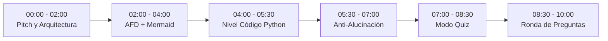

# Guion de Sustentación y Demostración: AulaIA 🎓🚀
**Duración Estimada:** 8 a 10 minutos  
**Asignatura:** Inteligencia Artificial y Teoría de la Computación  

---

## ⏱️ Minuto a Minuto de la Presentación

---

### [00:00 - 02:00] 1. Introducción, Problema y Arquitectura
- **Qué decir:**
  > *"Buenos días profesor y compañeros. Presentamos AulaIA, un tutor académico inteligente con recuperación aumentada por generación (RAG). Abordamos un problema común: cuando tenemos dudas para el examen parcial, los materiales están distribuidos en decenas de diapositivas y lecturas. Los LLMs comerciales como ChatGPT pueden alucinar o usar notaciones distintas a las de la cátedra. AulaIA responde garantizando que cada dato provenga estrictamente de las 8 presentaciones oficiales del curso, citando la diapositiva exacta y renderizando diagramas visuales en tiempo real."*
- **Qué mostrar en pantalla:**
  - Mostrar la interfaz de Streamlit (`http://localhost:8501`) abierta con el lanzador `iniciar_aulaia.bat`.
  - Destacar en la barra lateral el contador: **161 diapositivas indexadas en memoria con Búsqueda Híbrida (FAISS + BM25 con Reciprocal Rank Fusion)**.

---

### [02:00 - 04:00] 2. Prueba 1: Rigor Formal y Renderizado de Autómatas (Mermaid)
- **Pregunta a ingresar en el chat:**
  > `¿Cómo se define formalmente la 5-tupla de un autómata finito y cómo sería el diagrama de estados para reconocer cadenas binarias terminadas en 01?`
- **Configuración:** Selector en **📚 Formal (Nivel Examen)**.
- **Qué estás demostrando técnicamente:**
  - Recuperación de la 5-tupla formal ($Q, \Sigma, \delta, q_0, F$) extraída de la Clase 03.
  - Generación de la tabla de transición y el grafo visual interactivo en **Mermaid.js**.
  - Cita explícita: `[Fuente: 03 Introducción a la Teoría de los Autómatas 2026-2.pptx - Diapositiva 9]`.

---

### [04:00 - 05:30] 3. Prueba 2: Selector Pedagógico Adaptativo (Nivel Código)
- **Pregunta a ingresar:**
  > `Muéstrame la implementación en Python de un autómata a pila que reconozca el lenguaje a^n b^n.`
- **Configuración:** Cambiar el slider en la barra lateral a **💻 Práctico (Python)**.
- **Qué estás demostrando técnicamente:**
  - Capacidad de adaptar el *System Prompt* dinámicamente sin perder grounding.
  - El bot genera un script en Python con la lógica de pila LIFO (`push` y `pop`) fundamentado en las diapositivas de la Clase 06 de Autómatas a Pila.

---

### [05:30 - 07:00] 4. Prueba 3: Control Estricto Anti-Alucinación (Out of Domain)
- **Pregunta trampa:**
  > `Explícame cómo funciona el algoritmo de Backpropagation en Redes Neuronales Profundas.`
- **Qué estás demostrando técnicamente (El momento más impactante de la demo):**
  - El bot responderá amablemente:  
    > *"Esta consulta no se encuentra abordada en las diapositivas disponibles del curso (Clases 01 a 07.1). Te sugiero consultarlo en clase o revisar la bibliografía recomendada."*
  - **Explicación al jurado:** *"Esto demuestra que nuestro pipeline RAG tiene barreras de seguridad (guardrails): el modelo no inventa respuestas fuera del alcance documental establecido."*

---

### [07:00 - 08:30] 5. Prueba 4: Modo Simulador de Quiz Interactivo
- **Acción:**
  - Cambiar en el menú de la izquierda a **📝 Simulador de Quiz**.
  - Seleccionar tema: **Máquinas de Turing**.
  - Hacer clic en **🚀 Iniciar Autoevaluación**.
  - Marcar una respuesta en las opciones múltiples y presionar **Enviar y Calificar**.
- **Qué estás demostrando:**
  - Generación de JSON estructurado por parte del LLM.
  - Evaluación y retroalimentación pedagógica instantánea con confeti/globos y justificación en las diapositivas de Turing.

---

### [08:30 - 10:00] 6. Ronda de Preguntas Libres del Jurado
- Invitar al profesor:
  > *"Profesor, le cedemos la palabra para que le formule cualquier consulta del curso al asistente para comprobar su velocidad de recuperación y precisión documental."*

