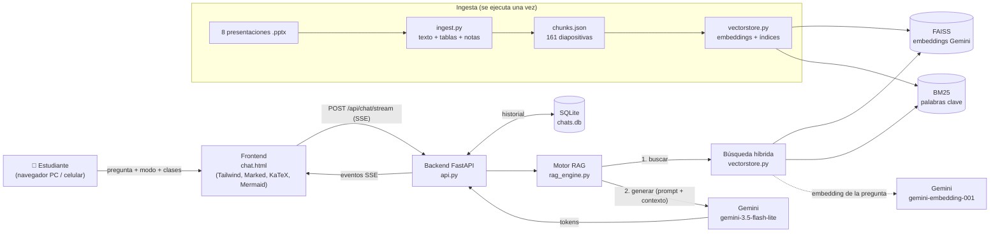
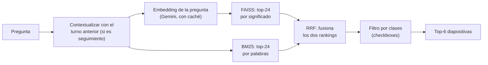

# AulaIA 🎓🤖

**Tutor académico con IA generativa para el curso de Inteligencia Artificial (Unidad 1: Teoría de Autómatas y Lenguajes Formales).**

AulaIA responde dudas del curso usando **únicamente las diapositivas oficiales de clase**: busca las diapositivas relevantes, se las entrega a Google Gemini como contexto y genera una respuesta citando el archivo y el número de diapositiva. Si la pregunta no es del curso, la rechaza en lugar de inventar.

> Proyecto final del curso — Opción 3: Chatbot de IA generativa con **RAG (Retrieval-Augmented Generation)**.

---

## Índice

1. [El problema y el usuario](#1-el-problema-y-el-usuario)
2. [Qué hace AulaIA](#2-qué-hace-aulaia)
3. [Arquitectura general](#3-arquitectura-general)
4. [Cómo funciona el RAG paso a paso](#4-cómo-funciona-el-rag-paso-a-paso)
5. [Prompt engineering](#5-prompt-engineering)
6. [Memoria y contexto de la conversación](#6-memoria-y-contexto-de-la-conversación)
7. [Flujos de conversación y manejo de errores](#7-flujos-de-conversación-y-manejo-de-errores)
8. [Frontend (interfaz)](#8-frontend-interfaz)
9. [API (endpoints)](#9-api-endpoints)
10. [Estructura del proyecto](#10-estructura-del-proyecto)
11. [Instalación y ejecución](#11-instalación-y-ejecución)
12. [Evaluación y resultados](#12-evaluación-y-resultados)
13. [Limitaciones y trabajo futuro](#13-limitaciones-y-trabajo-futuro)
14. [Glosario rápido](#14-glosario-rápido)
15. [Equipo](#15-equipo)

---

## 1. El problema y el usuario

**Problema.** El material del curso está repartido en 8 presentaciones (161 diapositivas). Para repasar antes de un examen el estudiante tiene que buscar a mano dónde estaba cada definición. Los chatbots generales (ChatGPT, Gemini web) ayudan, pero **pueden alucinar** o usar una notación distinta a la de la cátedra.

**Usuario objetivo.** Estudiantes del VII ciclo del curso de Inteligencia Artificial que necesitan repasar definiciones formales, ejemplos y ejercicios de autómatas.

**Objetivo del chatbot.** Responder en lenguaje natural, con la notación del curso, **fundamentado en las diapositivas** y diciendo de qué diapositiva sale cada respuesta.

---

## 2. Qué hace AulaIA

| Función | Descripción |
|---|---|
| 💬 Chat con streaming | La respuesta aparece palabra por palabra (como ChatGPT/Gemini). |
| 📚 Respuestas con fuentes | Cada respuesta termina con `[Fuente: archivo.pptx - Diapositiva N]` y las diapositivas usadas se muestran en tarjetas. |
| 🧭 3 modos pedagógicos | **Intuitivo** (analogías), **Formal** (tuplas y notación matemática), **Código Python** (implementaciones). |
| 🗂️ Filtro por clases | Checkboxes para buscar solo en ciertas presentaciones (p. ej. solo Clase 06 y 07). |
| 🧠 Memoria de conversación | Entiende preguntas de seguimiento ("¿y cuál es su función de transición?"). |
| 💾 Historial tipo Gemini | Las conversaciones se guardan (SQLite): abrir, continuar, renombrar y borrar. Recargar la página conserva el chat (`/chat?c=<id>`). |
| 📊 Diagramas y fórmulas | Diagramas de estados con **Mermaid**, fórmulas con **KaTeX**, bloques de código con barra de lenguaje fija y botón copiar. |
| 📝 Simulador de quiz | Genera preguntas de opción múltiple (5/10/15, fácil/medio/difícil) a partir de las diapositivas. |
| 🚫 Anti-alucinación | Rechaza temas fuera del curso (cocina, deportes, backpropagation…). |
| 📱 Web y móvil | Interfaz responsive, modo claro/oscuro, "arrastrar para recargar" en celular. |

---

## 3. Arquitectura general



**Stack tecnológico**

| Capa | Tecnología |
|---|---|
| Lenguaje | Python 3.12 |
| Backend / API | FastAPI + Uvicorn, streaming con Server-Sent Events (`sse-starlette`) |
| LLM (generación) | Google Gemini `gemini-3.5-flash-lite` (con modelo y API key de respaldo) |
| Embeddings | Google `gemini-embedding-001` (3072 dimensiones) |
| Base vectorial | FAISS (`IndexFlatIP`, similitud coseno) |
| Búsqueda léxica | BM25 (`rank-bm25`) |
| Fusión | Reciprocal Rank Fusion (RRF) |
| Persistencia | SQLite (historial de conversaciones) |
| Ingesta | `python-pptx` (también soporta PDF y Markdown) |
| Frontend | HTML + Tailwind CSS + Marked.js + KaTeX + Mermaid.js (sin frameworks pesados) |

> No usamos LangChain/LlamaIndex: el pipeline RAG está implementado a mano para entender y controlar cada pieza (ingesta → embeddings → FAISS + BM25 → RRF → prompt → Gemini).

---

## 4. Cómo funciona el RAG paso a paso

**RAG** = antes de preguntarle al LLM, **recuperamos** (Retrieval) la información relevante de nuestros documentos y se la damos como contexto para que **genere** (Generation) la respuesta basándose en ella. Gemini no "conoce" nuestras diapositivas: se las pasamos en cada pregunta.

### 4.1 Ingesta (offline, una vez) — `src/ingest.py`

1. Lee cada `.pptx` de `data/raw/`.
2. Por cada diapositiva extrae: el texto, las **tablas de transición convertidas a Markdown** y las **notas del orador**.
3. Cada diapositiva es un **chunk** (fragmento) con metadatos: archivo, número de diapositiva y tema.
4. Guarda todo en `data/processed/chunks.json` → **161 chunks**.

> ¿Por qué un chunk por diapositiva? Porque cada diapositiva ya es una unidad de tema (una definición, un ejemplo) y permite citar exactamente "Diapositiva N".

### 4.2 Indexación (offline, una vez) — `src/vectorstore.py`

Se construyen **dos índices** sobre los 161 chunks:

| Índice | Qué guarda | Bueno para |
|---|---|---|
| **FAISS (denso / semántico)** | El *embedding* de cada diapositiva: 3072 números generados por `gemini-embedding-001` que representan su **significado**. | Sinónimos y preguntas con otras palabras ("memoria auxiliar" ≈ "pila"). |
| **BM25 (léxico)** | Las palabras de cada diapositiva (sin tildes, sin palabras vacías, con siglas expandidas: AFND ↔ AFN, ε ↔ épsilon). | Términos exactos y siglas ("5-tupla", "q0", "AFND"). |

Archivos generados: `data/processed/faiss.index` y `data/processed/metadata.json`.

### 4.3 Recuperación (en cada pregunta)



- **Búsqueda híbrida:** se combinan los dos rankings con **RRF (Reciprocal Rank Fusion)**: `score = Σ 1 / (60 + posición)`. Una diapositiva que aparece arriba en ambos rankings gana.
- Si la API de embeddings falla en ese momento, la búsqueda **continúa solo con BM25** (no se cae).
- Se envían las **6 diapositivas** más relevantes al LLM.

### 4.4 Generación — `src/rag_engine.py`

Se arma el prompt con: **system prompt** (reglas) + **diapositivas recuperadas** dentro de `<contexto_documental>` + **historial** de la conversación + **pregunta**. Gemini responde en streaming y el backend reenvía cada fragmento al navegador por SSE.

---

## 5. Prompt engineering

El system prompt (`SYSTEM_PROMPT` en `src/rag_engine.py`) define:

1. **Rol:** "AulaIA, tutor académico de IA y Teoría de la Computación".
2. **Fidelidad estricta:** responder solo a partir de `<contexto_documental>`.
3. **Fuera de dominio:** si el tema no es del curso, responder con un mensaje fijo de rechazo (no inventar).
4. **Citas obligatorias:** cerrar cada respuesta con `**Fuentes consultadas:** [Fuente: archivo - Diapositiva N]`.
5. **Definiciones canónicas del curso:** la función de transición correcta de cada autómata (AFD, AFND, AFND-ε, AP, MT) con la notación de las diapositivas, para que no las mezcle.
6. **Modos pedagógicos:** reglas distintas para Intuitivo / Formal / Código.
7. **Formato:** diagramas Mermaid `stateDiagram-v2` válidos, sin saludos de relleno.

Técnicas usadas: *role prompting*, delimitadores XML (`<contexto_documental>`, `<historial_conversacion>`), instrucciones negativas explícitas, *few-shot* de formato (ejemplo de diagrama Mermaid) y `temperature = 0.15` para respuestas consistentes.

---

## 6. Memoria y contexto de la conversación

- **Memoria persistente (servidor):** cada mensaje se guarda en SQLite (`data/chats.db`). En cada pregunta el backend lee los **últimos 6 mensajes** (3 turnos) de esa conversación y los incluye en el prompt. El navegador no necesita enviar el historial.
- **Contextualización de la búsqueda:** si la pregunta depende del turno anterior ("¿y su definición formal?", "dame un ejemplo"), se busca con *pregunta anterior + pregunta actual*. Sin esto, la búsqueda no sabría de qué tema se habla.
- **Títulos automáticos** a partir de la primera pregunta (renombrables desde la interfaz).

Ejemplo real:
```
Estudiante: ¿Qué es un autómata a pila?
Estudiante: ¿Y cómo es su función de transición?
  → búsqueda: "¿Qué es un autómata a pila? ¿Y cómo es su función de transición?"
  → fuentes: Clase 06, diapositivas 6, 5, 9 …  (correcto)
```

---

## 7. Flujos de conversación y manejo de errores

**Flujo ideal:** pregunta del curso → búsqueda → respuesta en streaming con fuentes → se guarda en el historial.

**Flujos alternos:**

| Situación | Comportamiento |
|---|---|
| Pregunta fuera del curso | Mensaje de rechazo fijo, sin inventar. |
| Pregunta de seguimiento | Se usa la memoria + búsqueda contextualizada. |
| Pregunta vacía | Error 400 "La pregunta no puede estar vacía". |
| Gemini saturado (503) o límite por minuto (429) | Reintenta y cambia al modelo de respaldo; si existe, usa la API key de respaldo. |
| Gemini falla **a mitad** de una respuesta | El servidor envía el evento `reset`: el chat borra el texto parcial, muestra "Reintentando…" y empieza limpio (sin duplicar texto). |
| Falla la API de embeddings | La búsqueda sigue solo con BM25. |
| Sin API key | Modo demostración: muestra los fragmentos encontrados en las diapositivas. |
| Se agotan todos los reintentos | Aviso al usuario: "Se agotó la cuota… vuelve a consultar". |
| Error de base de datos | Se registra en el log y la conversación continúa. |
| Varias personas a la vez | Búsqueda y generación corren en hilos separados: el servidor atiende en paralelo. |

---

## 8. Frontend (interfaz)

- `static/index.html` → **landing** (presentación del proyecto, `http://localhost:8000/`).
- `static/chat.html` → **aplicación de chat** (`http://localhost:8000/chat`).
- `static/mobile.css` / `static/mobile.js` → adaptación a celular (menú ☰, pull-to-refresh, ajustes de teclado iOS).

Eventos SSE que recibe el chat desde `/api/chat/stream`:

| Evento | Contenido |
|---|---|
| `conversation` | ID de la conversación (se guarda en la URL `?c=`). |
| `sources` | Lista de diapositivas usadas (archivo, número, extracto). |
| `token` | Fragmento de texto de la respuesta. |
| `reset` | Descartar el texto parcial (reintento tras un error). |
| `done` | Fin de la respuesta. |
| `error` | Mensaje de error para mostrar. |

---

## 9. API (endpoints)

Documentación interactiva automática: **http://localhost:8000/docs** (Swagger de FastAPI).

| Método | Ruta | Para qué |
|---|---|---|
| `POST` | `/api/chat/stream` | Pregunta → respuesta en streaming (SSE). Body: `pregunta`, `nivel` (`intuitivo`/`formal`/`codigo`), `temas_filtro` (lista de archivos o `null`), `conversation_id`. |
| `POST` | `/api/quiz/generate` | Genera un quiz en JSON. Body: `tema`, `num_preguntas`, `dificultad`. |
| `GET` | `/api/topics` | Lista de presentaciones cargadas. |
| `GET` | `/api/chats` | Lista de conversaciones guardadas. |
| `POST` | `/api/chats` | Crea una conversación vacía. |
| `GET` | `/api/chats/{id}` | Mensajes de una conversación. |
| `PATCH` | `/api/chats/{id}` | Renombrar (`{"title": "..."}`). |
| `DELETE` | `/api/chats/{id}` | Borrar una conversación. |
| `GET` | `/api/health` | Estado: índice cargado, nº de diapositivas, modelo de embeddings, modelos LLM. |

---

## 10. Estructura del proyecto

```plaintext
BOT IA/
├── data/
│   ├── raw/                  # 8 presentaciones .pptx del curso (Clases 01 a 07.1)
│   ├── processed/
│   │   ├── chunks.json       # 161 diapositivas extraídas (texto + tablas + notas)
│   │   ├── faiss.index       # índice vectorial (embeddings Gemini, 3072 dim)
│   │   └── metadata.json     # metadatos + corpus BM25
│   └── chats.db              # historial de conversaciones (se crea solo, no se sube a git)
├── src/
│   ├── api.py                # FastAPI: endpoints, SSE, memoria desde SQLite
│   ├── rag_engine.py         # Motor RAG: prompt, contextualización, Gemini con reintentos, quiz
│   ├── vectorstore.py        # Embeddings, FAISS, BM25, RRF
│   ├── ingest.py             # Extracción de diapositivas → chunks.json
│   ├── database.py           # SQLite: conversaciones y mensajes
│   └── config.py             # Rutas, modelos y parámetros
├── static/
│   ├── index.html            # Landing
│   ├── chat.html             # App de chat
│   ├── mobile.css / .js      # Adaptación a celular
│   └── logo.svg, favicon.svg, usmp_logo.png
├── tests/
│   ├── eval_cases.json       # 25 casos de evaluación
│   ├── eval_rag.py           # Script de evaluación (recuperación + respuestas)
│   └── reports/              # Reportes generados (antes / fases / final)
├── iniciar_aulaia.bat        # Lanzador de 1 clic para Windows
├── requirements.txt
└── .env.example              # Plantilla de variables de entorno
```

---

## 11. Instalación y ejecución

### Requisitos
- Python 3.10+ (probado con 3.12)
- Una API key gratuita de Gemini: https://aistudio.google.com/

### Pasos

```bash
# 1. Instalar dependencias
pip install -r requirements.txt

# 2. Configurar la API key
copy .env.example .env        # (en Mac/Linux: cp .env.example .env)
#    y edita .env poniendo tu GEMINI_API_KEY

# 3. Iniciar el servidor
python -m uvicorn api:app --app-dir src --host 127.0.0.1 --port 8000
```

Abrir **http://localhost:8000** (landing) o **http://localhost:8000/chat** (chat).
En Windows también se puede usar doble clic en `iniciar_aulaia.bat`.

> El índice (`data/processed/`) ya viene generado, no hace falta reconstruirlo para usar el bot.

### Abrirlo desde el celular (misma red WiFi)

```bash
python -m uvicorn api:app --app-dir src --host 0.0.0.0 --port 8000
```
Luego en el celular: `http://<IP-de-la-PC>:8000/chat` (la IP se ve con `ipconfig`). Si no carga, permitir Python en el firewall de Windows para redes privadas.

### Reconstruir el índice (solo si se agregan o cambian diapositivas)

```bash
# 1. Copiar los .pptx nuevos a data/raw/
python src/ingest.py        # extrae las diapositivas → chunks.json
python src/vectorstore.py   # genera embeddings + FAISS + BM25 (~2 min por el límite gratuito de 100 embeddings/min)
```

### Variables de entorno (`.env`)

| Variable | Por defecto | Descripción |
|---|---|---|
| `GEMINI_API_KEY` | — | API key principal (obligatoria para respuestas con IA). |
| `GEMINI_API_KEY_BACKUP` | vacío | API key de respaldo si la principal agota su cuota. |
| `GEMINI_MODEL` | `gemini-3.5-flash-lite` | Modelo generativo. |
| `EMBEDDING_MODEL` | `gemini-embedding-001` | Modelo de embeddings. |
| `USE_GEMINI_EMBEDDINGS` | `true` | `false` usa un vectorizador local (sin semántica) como contingencia. |

> ⚠️ Si cambias código del backend con el servidor encendido, reinícialo (Ctrl+C y volver a iniciar). En Windows la recarga automática `--reload` a veces se queda colgada y sigue respondiendo con el código viejo.

---

## 12. Evaluación y resultados

Script: `tests/eval_rag.py` con **25 casos** (`tests/eval_cases.json`):

| Tipo | Casos | Qué prueba |
|---|---|---|
| Directa | 14 | Preguntas con términos del curso ("definición formal de un AFND"). |
| Parafraseada | 6 | Mismo tema con otras palabras ("memoria auxiliar" en vez de "pila"). |
| Fuera de dominio | 3 | Cocina, deportes, backpropagation → debe rechazar. |
| Seguimiento | 2 | Preguntas que dependen del turno anterior. |

```bash
python tests/eval_rag.py --tag demo          # solo recuperación (rápido)
python tests/eval_rag.py --tag demo --e2e    # + respuestas completas de Gemini (~5 min)
```
Genera `tests/reports/eval_<tag>.md` (tabla legible) y `.json` (incluye las respuestas completas).

### Métricas

- **Hit@3 diapositiva:** % de preguntas donde la diapositiva correcta está entre las 3 primeras recuperadas.
- **MRR (Mean Reciprocal Rank):** promedio de 1/posición de la diapositiva correcta (1.00 = siempre en primer lugar).
- **Rechazo fuera de dominio / falsos rechazos / citas / cobertura de conceptos clave / latencia.**

### Resultados de recuperación — antes vs. después

"Antes" = FAISS con un vectorizador de palabras (sin semántica). "Después" = embeddings de Gemini + contextualización de seguimiento.

| Búsqueda híbrida | Antes | Después |
|---|---|---|
| Hit@3 diapositiva (global) | 86% | **95%** |
| MRR (global) | 0.77 | **0.92** |
| Preguntas directas (Hit@3 / MRR) | 86% / 0.84 | **100% / 1.00** |
| Preguntas de seguimiento (MRR) | 0.33 | **1.00** |

Comparación de métodos (después):

| Método | Hit@3 diapositiva | MRR |
|---|---|---|
| Solo BM25 (palabras) | 91% | 0.80 |
| Solo FAISS (embeddings) | 95% | 0.94 |
| **Híbrido (RRF)** | **95%** | **0.92** |

### Resultados end-to-end (respuestas de Gemini) — `tests/reports/eval_final.md`

| Métrica | Resultado |
|---|---|
| Casos ejecutados sin error | 25 / 25 |
| Rechazo correcto de preguntas fuera del curso | **100%** |
| Falsos rechazos (preguntas del curso rechazadas) | **0%** |
| Respuestas del curso con cita de diapositiva | **100%** |
| Cobertura de conceptos clave | **93%** |
| Latencia hasta el primer token (mediana / p90) | 3.8 s / 5.7 s |
| Latencia total (mediana / p90) | 5.1 s / 6.0 s |

---

## 13. Limitaciones y trabajo futuro

- **Sinónimos regionales:** "parqueo" vs. "estacionamiento" — los embeddings encuentran la diapositiva correcta, pero BM25 no, y la fusión RRF la baja de posición (1 caso de 25).
- **Latencia (~4 s al primer token):** depende principalmente de Gemini en plan gratuito.
- **Cuotas del plan gratuito:** 100 embeddings/minuto (reconstruir el índice tarda ~2 min) y límite de peticiones por minuto del LLM (mitigado con reintentos, modelo y key de respaldo).
- **Solo cubre la Unidad 1** (las 8 presentaciones cargadas). Para más temas basta agregar los archivos y reconstruir el índice.
- **Trabajo futuro:** reranking con un modelo cross-encoder, reescritura de la pregunta con el LLM en lugar de reglas, umbral de relevancia para detectar preguntas fuera del curso antes de llamar al LLM, autenticación de usuarios y despliegue en la nube.

---

## 14. Glosario rápido

| Término | Significado |
|---|---|
| **LLM** | Modelo de lenguaje grande (aquí, Gemini). Genera texto. |
| **RAG** | Retrieval-Augmented Generation: buscar en nuestros documentos y darle eso al LLM como contexto. |
| **Chunk** | Fragmento de documento que se indexa (aquí, 1 diapositiva). |
| **Embedding** | Lista de números que representa el significado de un texto; textos parecidos → vectores cercanos. |
| **FAISS** | Librería de Meta para buscar rápidamente los vectores más cercanos (base de datos vectorial). |
| **BM25** | Algoritmo clásico de búsqueda por palabras (premia palabras raras que coinciden). |
| **RRF** | Reciprocal Rank Fusion: combina varios rankings en uno. |
| **Búsqueda híbrida** | Palabras exactas (BM25) + significado (embeddings) combinados. |
| **SSE** | Server-Sent Events: el servidor envía la respuesta por partes mientras se genera. |
| **Alucinación** | Cuando el LLM inventa información que no está en las fuentes. |
| **Hit@k / MRR** | Métricas de calidad de búsqueda (ver sección 12). |
| **TTFT** | Time To First Token: tiempo hasta que aparece la primera palabra. |

---

## 15. Equipo

| Rol | Integrante |
|---|---|
| Jefe de proyecto | _(nombre)_ |
| Ingeniero IA/ML | _(nombre)_ |
| Ingeniero Front-end | _(nombre)_ |
| QA / Tester | _(nombre)_ |
| Documentación | _(nombre)_ |

Curso de Inteligencia Artificial — VII ciclo, 2026-II.
